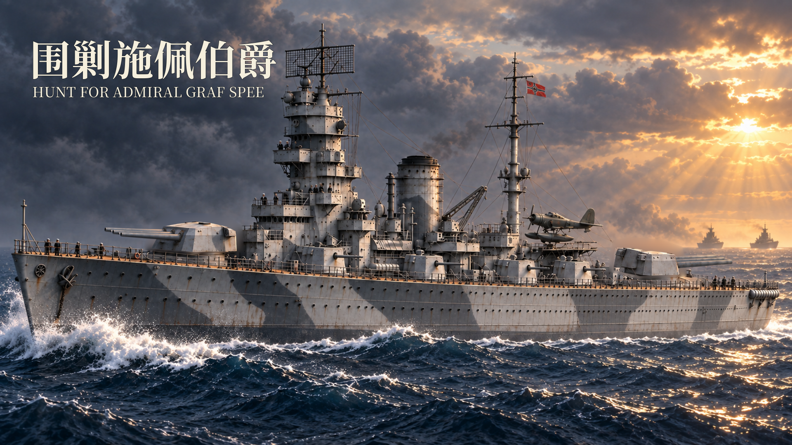
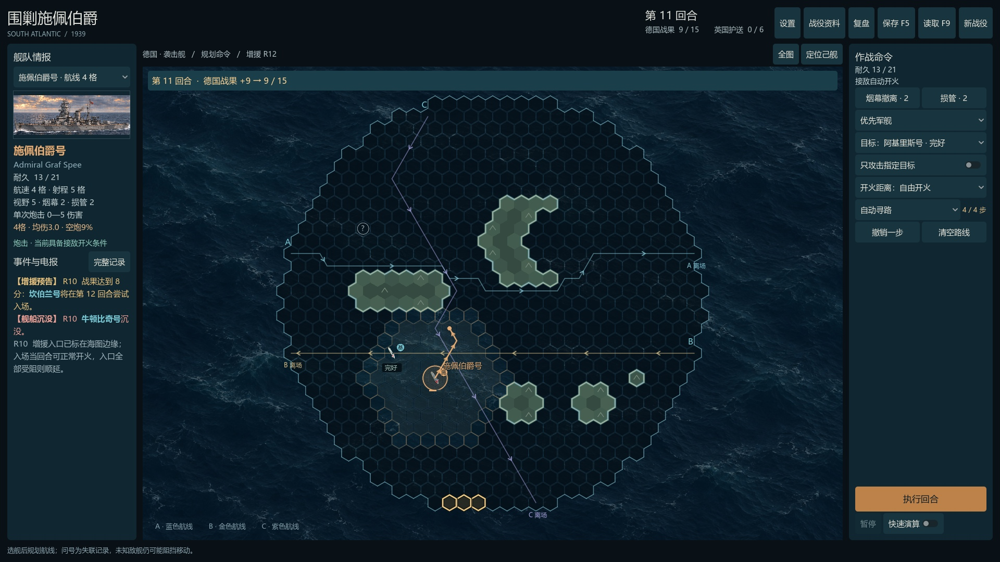
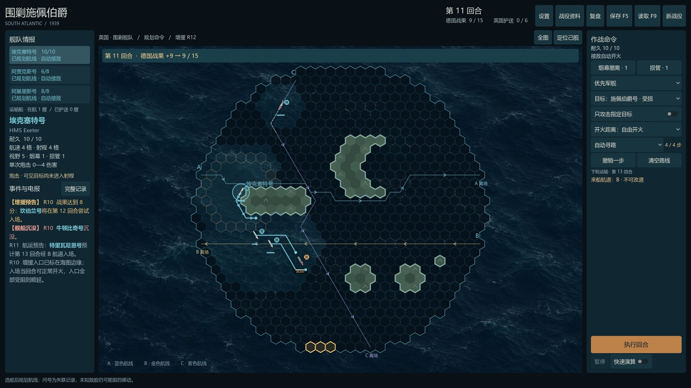
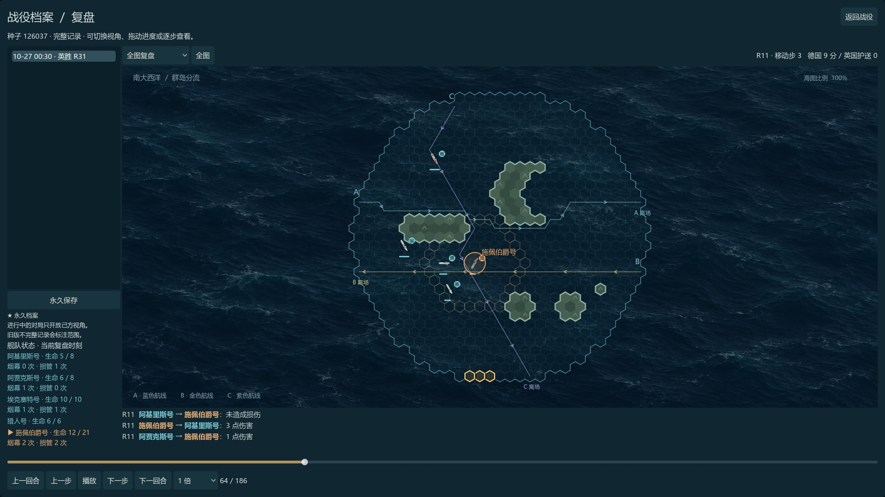

# 围剿施佩伯爵

1939年，南大西洋。指挥施佩伯爵号袭商与突围，或统率英国巡洋舰搜索、围堵并保护运输船。

这是一款中文非对称回合制海战战棋，支持 Windows 单人对战 AI 和同一局域网双人对战。

## 下载与运行

**[直接下载 Windows 试玩版 0.10.15（ZIP，约144MB）](https://github.com/deityfrost/hunt-for-graf-spee/releases/download/v0.10.15/GrafSpee-0.10.15-Windows.zip)**

备用入口：[最新发布页](https://github.com/deityfrost/hunt-for-graf-spee/releases/latest)。进入后在 **Assets** 中选择 `GrafSpee-0.10.15-Windows.zip`。

1. 下载 `GrafSpee-0.10.15-Windows.zip`。
2. 解压完整文件夹，再运行其中的 `GrafSpee.exe`。
3. 保留同目录的 `GrafSpee.pck`、`platform` 和 `LICENSES`；不要只复制 `.exe`。

支持 Windows 10/11 64位。无需安装 Godot，单人游玩无需联网或游戏账号。GitHub 自动生成的 `Source code` 压缩包只包含本发行仓库的说明和图片；游戏安装包请选上述 Windows ZIP。

当前游戏版本为 **0.10.15**，新局规则为 **0.4.14**，界面为中文。

## 怎么玩

- **双方下令，同时行动。** 规划航迹、射击距离和目标优先级，双方锁定命令后统一执行。
- **德国袭商，英国护航。** 德国积累战果并保持施佩存活；英国可以击沉施佩，也可以护送足够运输船离场。
- **在不完整情报下决策。** 岛屿、烟幕、最后接触位置和有限损管会影响追击、集火与撤离。
- **选择不同海域。** 四张预设海图与可重复种子的随机海域，支持存读档和战役复盘。
- **从教学开始。** 内含五节德军教学、战役资料和舰船图鉴。

## 局域网双人

两台电脑使用同一版本并连接同一局域网。房主从开局界面进入“局域网”创建房间，另一方查找房间，或粘贴房主复制的地址加入。详细步骤见压缩包中的《局域网联机说明.md》。

目前没有互联网匹配、观战、云存档或断线续局。局域网已做本机回环验证，两台实体电脑及具体路由器环境仍欢迎试玩反馈。

## 操作与反馈

空格执行、暂停或继续；Tab切换己方军舰；F1查看战役资料；F5保存；F9读取；M静音；Esc打开战役菜单。完整规则及说明随包提供。

遇到问题或有玩法建议，可在 **[Issues](https://github.com/deityfrost/hunt-for-graf-spee/issues)** 留言。请尽量附上版本、地图、战役种子、回合、操作过程和复盘信息。

本仓库用于分发 Windows 试玩包及公开资料，不包含游戏开发源码。素材来源及第三方许可见压缩包中的《素材说明.md》和 `LICENSES`。

本作以拉普拉塔河口海战和历史舰船为背景；海域、运输任务、胜负条件及部分机制经过游戏化改编。插画并非历史照片或精确复原。
